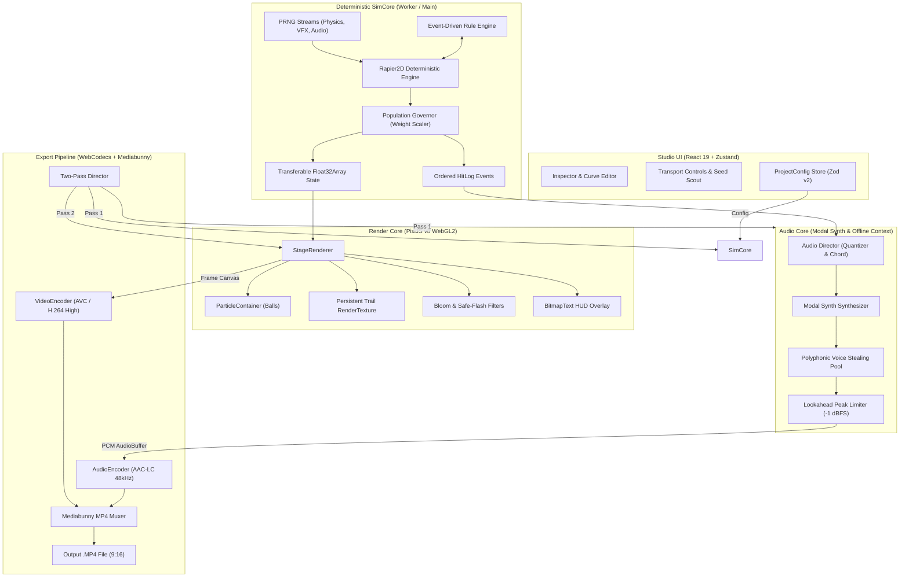
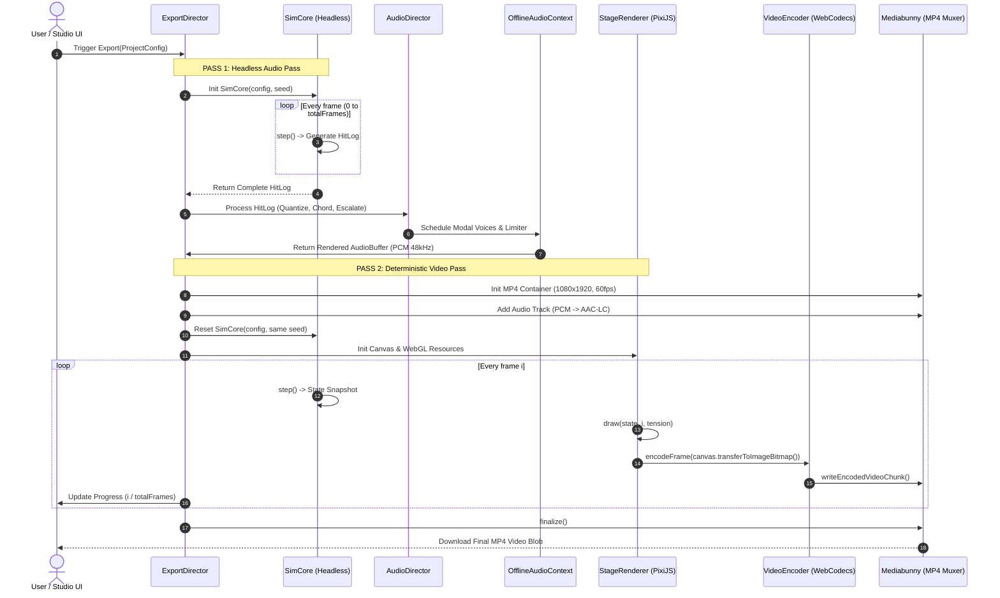

# Technical Design Document
**Ticket:** `20261110-TKT01-ASMR-VIDEO-STUDIO`  
**Feature:** Procedural Physics & Algorithm ASMR Video Studio  
**Date:** 2026-11-10  
**Version:** 2.0  
**Status:** `APPROVED` (`process = Yes`)  

---

## 1. Arsitektur Sistem Global

Prinsip arsitektur fundamental sistem ini adalah **Zero Coupling antara Fisika, Visual, dan Audio**:
1. **SimCore:** Berjalan secara murni deterministik (headless). Tidak memiliki ketergantungan pada DOM, WebGL, PixiJS, atau Web Audio API. Menghasilkan *State Snapshot* dan *HitLog*.
2. **AudioRenderer:** Fungsi murni dari *HitLog*. Live preview dan export offline menggunakan struktur synthesis graph yang sama persis.
3. **StageRenderer:** Fungsi murni dari `(State, FrameIndex)`. Menggambar representasi visual ke HTML5 Canvas menggunakan PixiJS v8.
4. **Exporter:** Mengonsumsi Canvas Source (VideoEncoder H.264) dan AudioBuffer (AudioEncoder AAC) lalu dimux ke wadah MP4 melalui Mediabunny.



---

## 2. Struktur Modul & Monorepo Packages

Repo menggunakan arsitektur monorepo `pnpm workspace` dengan pemisahan dependensi ketat:

```
asmr-studio/
├── pnpm-workspace.yaml
├── package.json
├── packages/
│   ├── schema/              # Zod ProjectConfig v2, migrasi tipe, default presets
│   │   ├── src/index.ts
│   │   ├── src/types.ts
│   │   └── src/presets.ts
│   ├── sim-core/            # Pure TS: PRNG, Rapier wrapper, Governor, Rules, EventLog
│   │   ├── src/prng/
│   │   ├── src/physics/
│   │   ├── src/governor/
│   │   ├── src/rules/
│   │   └── src/SimCore.ts
│   ├── audio-core/          # Modal Synth, Scale/Chord Quantizer, Offline/Live Mixer
│   │   ├── src/modal/
│   │   ├── src/quantizer/
│   │   ├── src/mixer/
│   │   └── src/AudioDirector.ts
│   └── render-core/         # PixiJS v8 scenes, particle shaders, bloom, trails, HUD
│       ├── src/stage/
│       ├── src/particles/
│       ├── src/filters/
│       └── src/hud/
└── apps/
    └── studio/              # React UI: Timeline, Tension Spline, Viewport, WebCodecs Exporter
        ├── src/components/
        ├── src/store/
        └── src/exporter/
```

---

## 3. Komponen Utama & Desain Algoritma

### 3.1 PRNG Seed Stream Isolation
Untuk memastikan efek visual atau variasi audio tidak merusak determinisme fisika:
```typescript
export class SeededRNGPool {
  public readonly physics: PRNG;
  public readonly vfx: PRNG;
  public readonly audio: PRNG;

  constructor(masterSeed: number) {
    // Turunkan sub-seed menggunakan hash FNV-1a
    this.physics = createSfc32(hashFnv1a(`${masterSeed}:physics`));
    this.vfx = createSfc32(hashFnv1a(`${masterSeed}:vfx`));
    this.audio = createSfc32(hashFnv1a(`${masterSeed}:audio`));
  }
}
```

### 3.2 Population Governor
Menjamin FPS tetap 60 dengan membatasi jumlah *RigidBody* fisika aktual:
- `V`: Virtual balls (tampil di HUD).
- `P`: Physical balls (disimulasikan oleh Rapier, $P \le \text{physical\_cap}$).
- Algoritma saat spawn `N` virtual:
  ```typescript
  if (P < physical_cap) {
    const alloc = Math.min(N, physical_cap - P);
    const weightPerNewBall = Math.max(1, Math.ceil(N / alloc));
    spawnPhysicalBalls(alloc, weightPerNewBall);
    P += alloc;
    V += N;
  } else {
    // Kapasitas fisik penuh: tingkatkan bobot bola yang ada
    const scaleFactor = (V + N) / V;
    for (const ball of activeBalls) {
      ball.weight *= scaleFactor;
    }
    V += N;
  }
  ```
- Visual Radius scaling: $r_{\text{visual}} = r_{\text{base}} \cdot (1 + 0.15 \cdot \log_{10}(\text{weight}))$.

### 3.3 Modal Synthesis & Prerendering
Suara fisik tanpa file audio eksternal berbasis spektrum moda getaran:
$$s(t) = \sum_{k=0}^{M-1} a_k \cdot \sin(2\pi \cdot f_0 \cdot r_k \cdot t) \cdot e^{-t / \tau_k}$$
- **Kalimba Glow:** $r = [1.0, 6.27, 17.55]$, $\tau = [1.0, 0.4, 0.1]$, $a = [1.0, 0.35, 0.12]$.
- **Glass Bell:** $r = [1.0, 2.76, 5.40, 8.93]$, $\tau = [1.8, 1.2, 0.7, 0.4]$, $a = [1.0, 0.6, 0.4, 0.2]$.
- **Marimba Wood:** $r = [1.0, 4.0, 10.0]$, $\tau = [0.35, 0.2, 0.08]$, $a = [1.0, 0.5, 0.25]$.
- **Thocky Keys:** Noise burst 5 ms + Bandpass 1800 Hz + Sub sine 140 Hz ($\tau = 0.06\text{s}$).

**Trik Performa:** Saat scene diinisialisasi, 40 nada rentang MIDI (C3–E6) di-synthesize ke dalam `AudioBuffer` 48 kHz. Trigger nada di runtime hanya berupa `AudioBufferSourceNode` yang di-lookup secara instan dalam memori $O(1)$.

### 3.4 Musical Quantizer & Chord Aggregation
1. **Sliding Window Density Aggregator:**
   - Menampung hit event dalam sliding window 30 ms.
   - Jika $\text{count} \ge 6$: konversi menjadi *Chord Event* (root + terts + kuint dari skala harmonik aktif) dengan velocity kompresi eksponensial $v_{\text{chord}} = \min(1.0, (\sum v)^{0.6} / 2.5)$.
2. **Musical Quantizer Modes:**
   - `HARMONIC`: Mengunci nada pada skala musik aktif (`pentatonic_major`, `dorian`, `lydian`).
   - `GRID`: Menggeser waktu trigger ke titik grid ketukan terdekat jika $|\Delta t| \le 30\text{ ms}$.

### 3.5 Tension Curve Spline Evaluator
Interpolasi Catmull-Rom atau Monotone Cubic Hermite Spline atas pasangan titik $(t_i, v_i)$ pada rentang $t \in [0.0, 1.0]$.
```typescript
function evaluateTension(curve: [number, number][], progress: number): number {
  // Clamp progress [0, 1] dan hitung nilai interpolasi halus
  // Output: tension normal 0.0 s/d 1.0
}
```

### 3.6 Two-Pass Deterministic Exporter Sequence



---

## 4. Skema Data & Kontrak Integritas (ProjectConfig v2)

```typescript
export interface ProjectConfig {
  version: "2.0";
  seed: number;
  meta: {
    title: string;
    duration_sec: number;
    fps: 60 | 30;
    width: number;  // 1080
    height: number; // 1920
  };
  arc: {
    hook_text: string;
    tension_curve: [number, number][]; // [[t, tension], ...]
    loop_outro_sec: number;
  };
  physics: {
    pixels_per_meter: number; // 20
    gravity: [number, number]; // [0, 9.81]
    substeps: number; // 4
    max_speed: number; // 60
    restitution_default: number; // 0.98
    ball_ball_collision: boolean; // false
    physical_cap: number; // 3000 (preview) / 8000 (export)
  };
  scene: TowerBreakerSceneConfig | MazeEscapeSceneConfig | AlgorithmArenaConfig;
  sound: SoundConfig;
  look: LookConfig;
  rules: RuleConfig[];
}
```

---

## 5. Status Approval Dokumen Desain

- **Status:** `APPROVED` (`process = Yes`)
- **Reviewer Checklist:**
  - [x] Pemisahan arsitektur zero-coupling SimCore, AudioCore, RenderCore.
  - [x] Algoritma Population Governor menjaga performa di bawah batas fisik.
  - [x] Pre-rendering modal synthesis menghapus latensi audio.
  - [x] Two-pass export menjamin akurasi audio dan frame video bit-for-bit.
