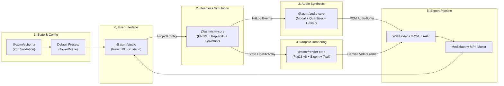

# Integration Mapping Document
**Ticket:** `20261110-TKT01-ASMR-VIDEO-STUDIO`  
**Feature:** Procedural Physics & Algorithm ASMR Video Studio  
**Date:** 2026-11-10  
**Version:** 2.0  
**Status:** `APPROVED` (`process = Yes`)  

---

## 1. Modul Integrasi Antar-Subsistem

---

## 2. Pemetaan Antarmuka Integrasi

| Dari Modul | Ke Modul | Format Data Transfer | Mekanisme Komunikasi |
|---|---|---|---|
| `Studio UI` | `SimCore` | `ProjectConfig` object | Direct instance / Web Worker `postMessage` |
| `SimCore` | `RenderCore` | `SimStateSnapshot` (`Float32Array`) | Zero-copy Transferable ArrayBuffer |
| `SimCore` | `AudioCore` | `AudioEvent[]` (`HitLog`) | Structured Array pass |
| `AudioCore` | `Export Pipeline` | `AudioBuffer` (PCM Stereo 48 kHz) | `AudioBufferSourceNode` -> `AudioData` WebCodecs |
| `RenderCore` | `Export Pipeline` | `HTMLCanvasElement` / `ImageBitmap` | `VideoFrame(canvas)` WebCodecs |
| `WebCodecs` | `Mediabunny` | `EncodedVideoChunk` & `EncodedAudioChunk` | Stream write to Memory/File Target |
| `Mediabunny` | `Studio UI` | `Uint8Array` / `Blob` (`video/mp4`) | File download trigger |

---

## 3. Integrasi Eksternal (Third-Party Libraries)
- **Rapier2D (`@dimforge/rapier2d`):** Diintegrasikan melalui WebAssembly binary loader deterministik.
- **PixiJS v8 (`pixi.js`):** Menggunakan pipeline WebGL2 teroptimasi untuk batch rendering jutaan partikel via sprite pooling.
- **Mediabunny (`mediabunny`):** Menggantikan pustaka lama (`mp4-muxer`) untuk standarisasi muxing AVC/AAC ke ISO Base Media File Format (MP4).
